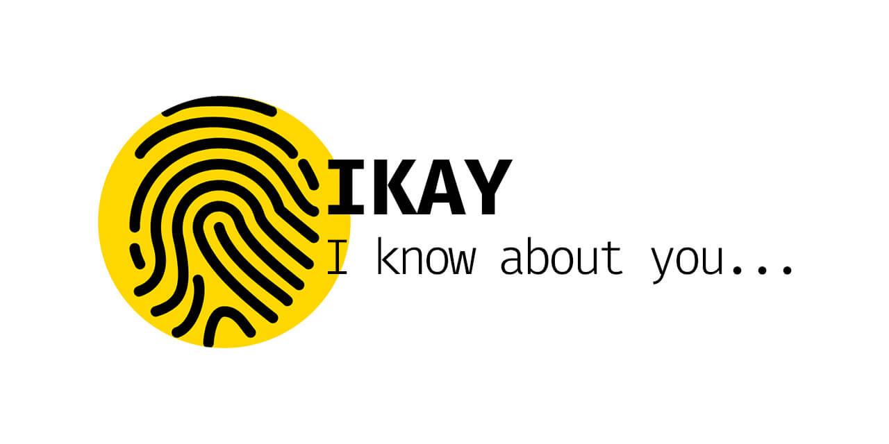

# IKAY · Browser fingerprint (vanilla)

> **Versión moderna de [IKAY](https://github.com/nandovejer/ikay)**, el proyecto original. Mismo propósito, reescrito en HTML, CSS y JavaScript nativos: sin npm, sin bundler, sin preprocesadores y sin dependencias.
>
> **Modern version of [IKAY](https://github.com/nandovejer/ikay)**, the original project. Same purpose, rewritten in plain HTML, CSS and JavaScript: no npm, no bundler, no preprocessors, no dependencies.

**DEMO: https://nandovejer.github.io/ikay-vanilla/**



Hi, I'm Nando Muñoz. IKAY is a tool to visualize, identify and manage your browser fingerprint. It shows a dashboard with part of the information you hand over to a website every time you visit it, **without asking for a single permission**, and explains in plain language what each piece of data means for you.

Este repositorio conserva la idea original porque me gusta ver cómo hemos evolucionado generando código a mano. El original sigue en [nandovejer/ikay](https://github.com/nandovejer/ikay) (Webpack, SCSS y `ua-parser-js`); aquí está la misma herramienta con la plataforma web de 2026.

## What it is

IKAY reads 33 pieces of data that any website gets from a browser with its default settings, and presents them like a dossier a website keeps on you:

- **A sentence per data point**, with the value in bold: "Tu pantalla mide **1920 × 1080 píxeles**."
- **A status on every card**: 🛡 _Protegido_ (green) when your browser keeps that data to itself, ⚠ _No protegido_ (red) when it hands it over.
- **"What it means for you"** in everyday words, and the technical detail folded away for the curious.
- **A summary sheet** ("Tu expediente, hasta ahora") with the data found so far and how many are shared, in your favour, and how many permissions were asked (always 0).
- **"Your ID"**: one hash that mixes every stable piece of data. It survives cookies and incognito mode, and it is computed again on every visit; nothing is stored or sent.

### What it shows

| Section             | Data                                                                                                                           |
| ------------------- | ------------------------------------------------------------------------------------------------------------------------------ |
| Your ID             | The cookieless fingerprint                                                                                                     |
| Geolocation         | City, country and map from your IP (ipapi.co)                                                                                  |
| General information | Device, screen, orientation, dark mode, language, your previous visits                                                         |
| Your environment    | Time zone (compared with your IP's: VPN hint), regional formats, window and screen details, accessibility, pointer, keyboard   |
| Software            | Operating system and browser                                                                                                   |
| Connection          | Download speed, internet provider, IP                                                                                          |
| Hardware            | RAM, CPU cores and architecture, GPU (WebGL and WebGPU)                                                                        |
| Battery             | Level, charging state and times                                                                                                |
| Active fingerprints | Canvas, audio, installed typefaces, speech voices                                                                              |
| Privacy             | Incognito detection, ad blocker, Do Not Track / GPC and other flags, how you arrived                                           |
| Behaviour           | Live mouse trail, clicks, scroll, keys, tab switches, time on page and phone motion sensors (never stored)                     |

Motion sensors never trigger a permission prompt: Android shares them freely, iOS and desktop count as protected.

## Design

- **Concept:** "the file a website keeps on you": paper and ink, numbered chapters and entries, one alarm-red accent used like a highlighter.
- **Type:** Fraunces for headings, Inter Tight for reading and Fira Code for every value found.
- **Themes:** Auto (follows your system), Light and Dark, remembered and applied before first paint. The "Dark mode" card keeps reporting the system setting.
- **Accessible:** WCAG 2.2 AA contrast, keyboard navigation, `prefers-reduced-motion`, native `<dialog>` and Popover, and logical properties so Arabic (RTL) needs no special cases.
- **Languages:** Español, English and العربية.

## Run it

There is nothing to install or build. The browser runs the repository as it is; you only need a static server, because ES modules do not load from `file://`.

```sh
$ python3 -m http.server 3000
```

Open http://localhost:3000. Any other static server works as well, for example `npx serve` or the VS Code _Live Server_ extension.

### Publish on GitHub Pages

_Settings → Pages → Build and deployment → Deploy from a branch_, pick the branch and the `/ (root)` folder. No build and no workflow: the repository is the website. The empty `.nojekyll` file tells GitHub Pages to serve the files as they are, without Jekyll.

## Project structure

```
.
├── index.html            # page skeleton + every <template>
├── favicon.ico
├── .nojekyll             # GitHub Pages: serve files as they are
├── .claude/agents/       # ux-web-2026: the UX design agent used for the redesign
└── assets/
    ├── css/
    │   ├── app.css       # entry point, @imports inside cascade layers
    │   ├── settings/     # design tokens: custom properties, oklch, light-dark()
    │   ├── generic/      # normalize + reset
    │   ├── elements/     # bare html elements
    │   ├── objects/      # icons (masks painted with currentColor)
    │   ├── components/   # card, modal, battery, nav, share
    │   └── sections/     # header, main, footer, loading
    ├── js/
    │   ├── app.js        # entry point (<script type="module">)
    │   ├── i18n.js       # translations: t(), data-i18n, Intl
    │   ├── modules/      # UI: templates, cards, summary, modal, nav, theme, share, storage…
    │   └── webapi/       # one module per piece of data read from the browser
    ├── locales/          # one JSON per language
    └── images/
```

### Adding a card

1. Write a detector in `assets/js/webapi/` that returns `{ value, detail?, list?, fingerprint?, win?, note? }` (see `webapi.js`).
2. Register it in `DETECTORS` in `webapi.js` and add its type to a `data-cards` section in `index.html`.
3. Add its texts (`title`, `sentence`, `protected`, `plain`, `modalinfo`…) to every JSON in `assets/locales/`, and an icon in `assets/images/svg/`.

## From the original IKAY to this version

| [Original](https://github.com/nandovejer/ikay) | Now                                                            |
| ---------------------------------------------- | -------------------------------------------------------------- |
| Webpack + Babel + BrowserSync                  | Native ES modules, no build step                               |
| SCSS (variables, mixins, `@extend`)            | CSS custom properties, native nesting and cascade layers       |
| HTML inside JS template strings                | `<template>` elements in `index.html`, cloned with `cloneNode` |
| `import en from "./en.json"` (bundler)         | `fetch` + top-level `await`, only the active language          |
| `ua-parser-js`                                 | Own parser: User-Agent Client Hints, `userAgent` as fallback   |
| Build output in `docs/`, sources in `src/`     | One tree: the repository root is the website                   |
| `XMLHttpRequest` and callbacks                 | `fetch`, `async/await`, `Promise.allSettled`                   |
| ESLint, Stylelint, Travis CI                   | Removed                                                        |
| 16 cards, all the same gold box                | 33 cards in numbered chapters, with status and plain language  |

## Translations (i18n)

Texts live in `assets/locales/{lang}.json`. The templates ask for them declaratively:

```html
<span data-i18n="header.location"></span>                   <!-- textContent -->
<div data-i18n-html="main.intro.content1"></div>            <!-- innerHTML -->
<button data-i18n-attr="title:main.cardmore"></button>      <!-- attributes -->
```

From JavaScript, use `t()`; `{0}`, `{1}`… are replaced by the extra arguments:

```js
import { t } from "../i18n.js";

t("global.shareIn", "twitter"); // "Share on twitter"
```

The language is the one chosen in the menu (saved in `localStorage`) or else the first of `navigator.languages` that we support. `Intl` does the rest: `Intl.DisplayNames` names each language in its own language, and `Intl.Locale` gives the text direction (`rtl` for Arabic).

**Add a language:** copy `en.json` to `xx.json`, translate it and add `"xx"` to `LANGS` in `assets/js/i18n.js`.

## Browser support

Current versions of Chrome, Edge, Firefox and Safari: ES modules, top-level `await`, CSS nesting, `light-dark()` and `<dialog>`. Some data is only available in Chromium (keyboard layout, memory, connection type); in the other browsers those cards show up as protected, which is part of the point.

## License

MIT
