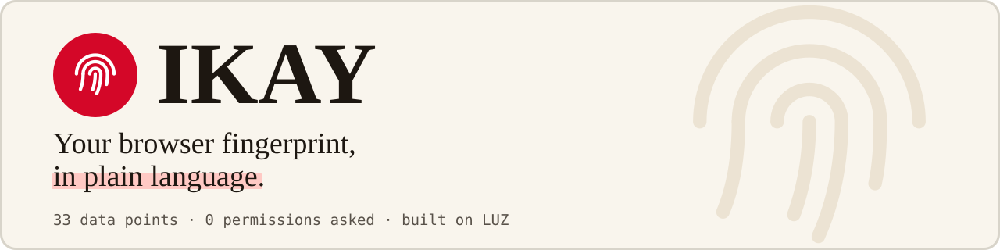
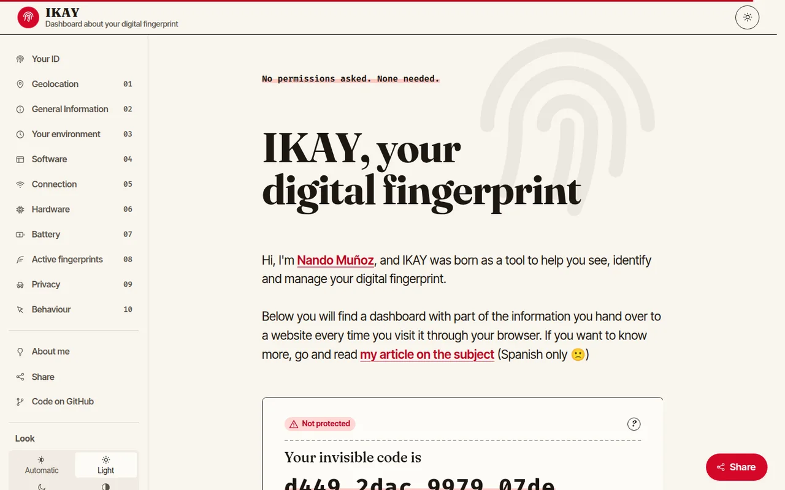
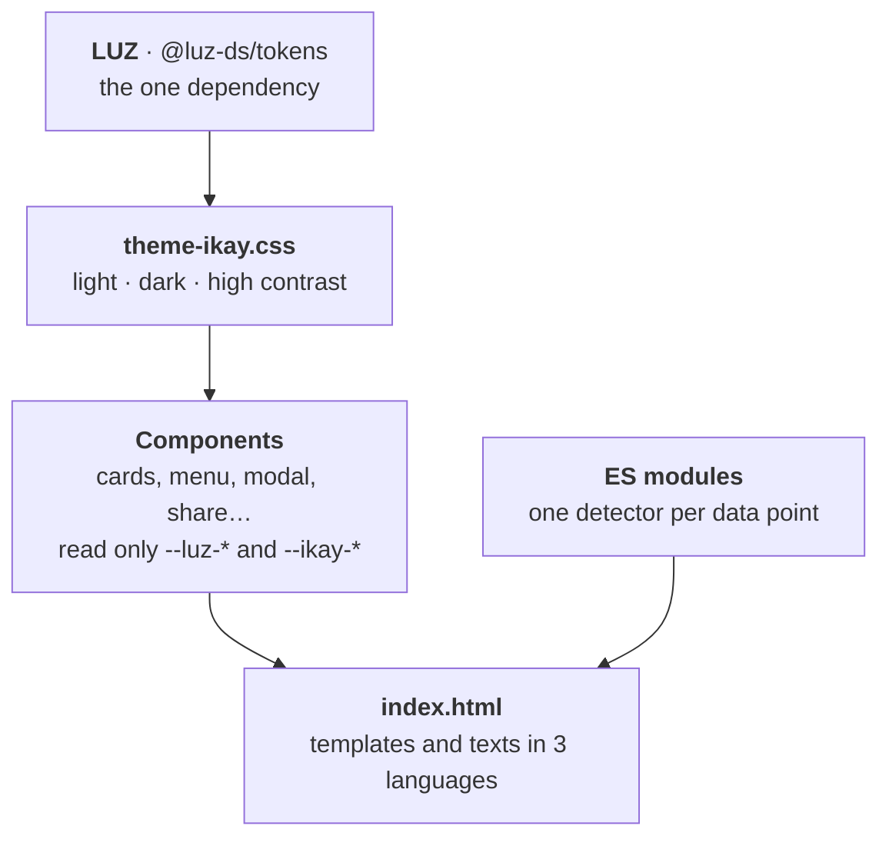
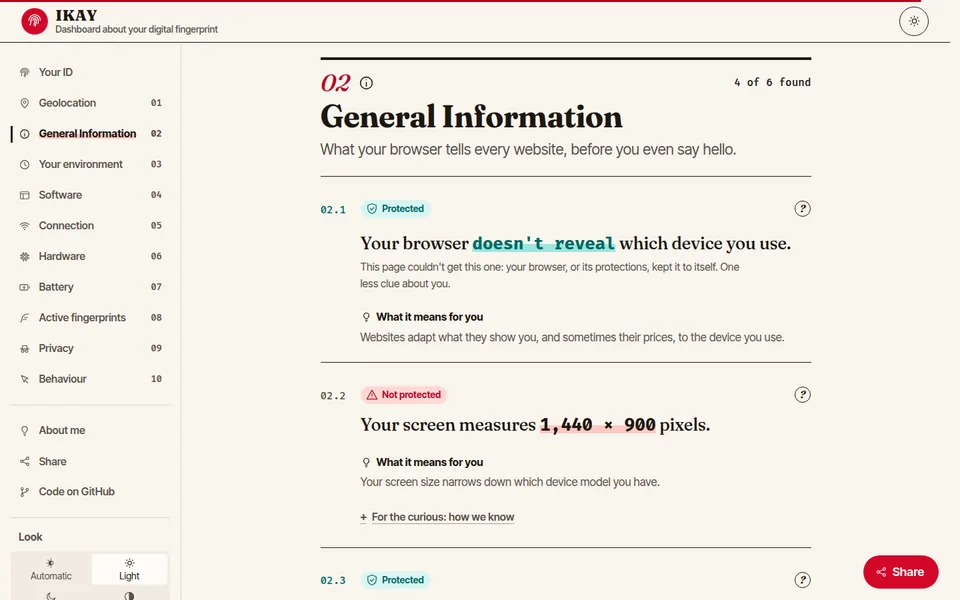
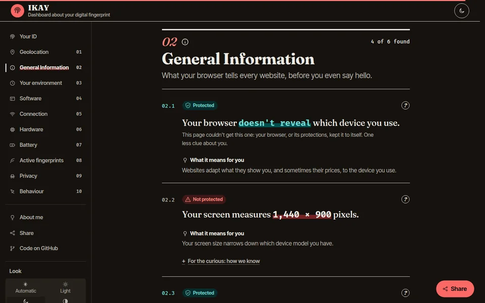
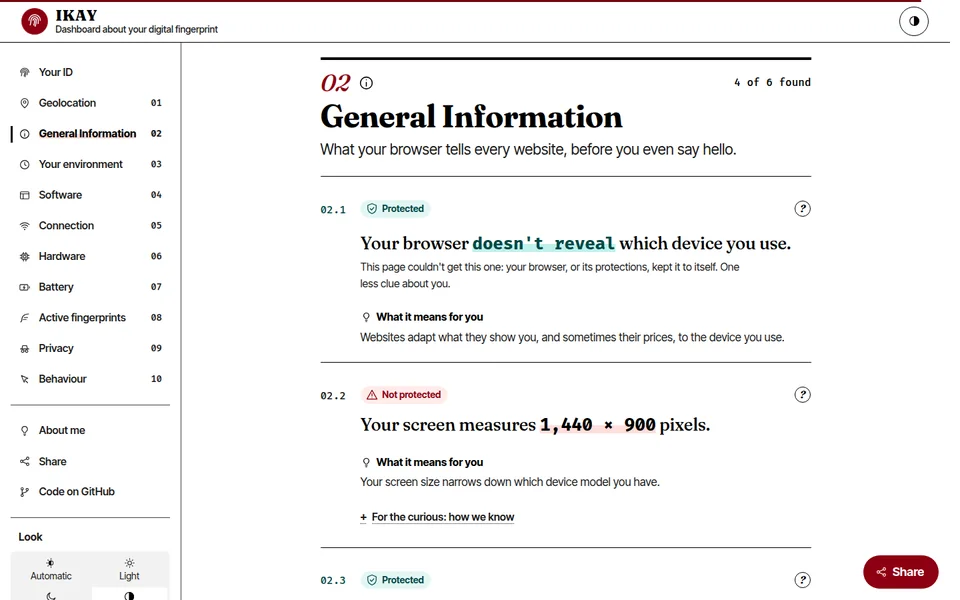

<div align="center">

<a href="https://nandovejer.github.io/ikay-vanilla/">
  <picture>
    <source media="(prefers-color-scheme: dark)" srcset=".github/assets/readme/banner-dark.svg">
    
  </picture>
</a>

[](https://nandovejer.github.io/ikay-vanilla/)
[](https://github.com/nandovejer/luz)


[](./LICENSE)

[What it shows](#what-it-shows) ·
[Built on LUZ](#built-on-luz) ·
[Accessibility](#accessibility) ·
[Run it](#run-it) ·
[Work on IKAY](#work-on-ikay) ·
[Credits](#credits)

</div>

---

<p align="center">
  <picture>
    <source media="(prefers-color-scheme: dark)" srcset=".github/assets/readme/screenshot-dark.webp">
    
  </picture>
</p>

> **The modern version of [IKAY](https://github.com/nandovejer/ikay)**, the original project. Same purpose, written in plain HTML, CSS and JavaScript on top of the [LUZ](https://github.com/nandovejer/luz) design tokens. **One dependency, LUZ**, and nothing else to install: no bundler, no preprocessor, no framework.

**DEMO: https://nandovejer.github.io/ikay-vanilla/**

Hi, I'm Nando Muñoz. IKAY is a tool to visualize, identify and manage your browser fingerprint. It shows a dashboard with part of the information you hand over to a website every time you visit it, **without asking for a single permission**, and explains in plain language what each piece of data means for you.

The original still lives at [nandovejer/ikay](https://github.com/nandovejer/ikay) (Webpack, SCSS and `ua-parser-js`); this is the same tool built with the 2026 web platform.

## What it shows

IKAY reads 33 pieces of data that any website gets from a browser with its default settings, and presents them like a dossier a website keeps on you:

- **A sentence per data point**, with the value in bold: "Your screen is **1920 × 1080 pixels**."
- **A status on every card**: 🛡 _Protected_ (green) when your browser keeps that data to itself, ⚠ _Not protected_ (red) when it hands it over.
- **"What it means for you"** in everyday words, and the technical detail folded away for the curious.
- **A summary sheet** ("Your file, so far") with the data found so far and how many are shared, in your favour, and how many permissions were asked (always 0).
- **"Your ID"**: one hash that mixes every stable piece of data. It survives cookies and incognito mode, and it is computed again on every visit; nothing is stored or sent.

| Section             | Data                                                                                                                           |
| ------------------- | ------------------------------------------------------------------------------------------------------------------------------ |
| Your ID             | The cookieless fingerprint                                                                                                     |
| Geolocation         | City, country and map from your IP (ipapi.co)                                                                                  |
| General information | Device, screen, orientation, dark mode, language, your previous visits                                                         |
| Your environment    | Time zone (compared with your IP's: VPN hint), regional formats, window and screen details, accessibility, pointer, keyboard   |
| Software            | Operating system and browser                                                                                                   |
| Connection          | Download speed, internet provider, IP                                                                                          |
| Hardware            | RAM, CPU cores and architecture, GPU (WebGL and WebGPU)                                                                        |
| Battery             | Level, charging state and times                                                                                                |
| Active fingerprints | Canvas, audio, installed typefaces, speech voices                                                                              |
| Privacy             | Incognito detection, ad blocker, Do Not Track / GPC and other flags, how you arrived                                           |
| Behaviour           | Live mouse trail, clicks, scroll, keys, tab switches, time on page and phone motion sensors (never stored)                     |

Motion sensors never trigger a permission prompt: Android shares them freely, iOS and desktop count as protected.

## Design

- **Concept:** "the file a website keeps on you": paper and ink, numbered chapters and entries, one alarm-red accent used like a highlighter.
- **Type:** Fraunces for headings, Inter Tight for reading and Fira Code for every value found.
- **Looks:** Auto (follows your system), Light, Dark and High contrast, remembered and applied before the first paint. The "Dark mode" card keeps reporting the system setting.
- **Accessible:** WCAG 2.2 AA contrast, keyboard navigation, `prefers-reduced-motion`, native `<dialog>` and Popover, and logical properties so Arabic (RTL) needs no special cases. [More below](#accessibility).
- **Languages:** Spanish, English and Arabic (right-to-left).

## Built on LUZ

IKAY is a theme of [LUZ](https://github.com/nandovejer/luz), the design system in plain HTML, CSS and ES modules. LUZ sets the colours, the type roles, the sizes, the corners, the shadows and the motion as CSS custom properties; IKAY gives them its own values, and every component reads them.



The theme overrides semantic tokens only, in the three LUZ colour modes, and never touches a primitive:

```css
[data-theme="ikay"] {
  --luz-surface-page: #f9f5ed; /* warm paper */
  --luz-brand-fill: #d40728; /* the one alarm crimson */
  /* … */
}

[data-theme="ikay"][data-mode="dark"] {
  --luz-surface-page: #15120e;
  --luz-brand-fill: #fa6865;
  /* … */
}
```

Components say `var(--luz-surface)`, `var(--luz-text-primary)`, `var(--luz-space-md)`, `var(--luz-radius-md)`, `var(--luz-duration-base)`. The few things LUZ has no token for (fluid type and space steps, layout measures, the stronger hairline and the icon files) are `--ikay-*`, in [`variables.css`](assets/css/settings/variables.css).

### What the site loads

| What | Where | Note |
| --- | --- | --- |
| **LUZ tokens 0.3.0** | [`assets/vendor/luz/`](assets/vendor/luz) | **The only dependency.** A copy of `@luz-ds/tokens` (MIT), kept in the repository so the site is served as it is and no visitor's IP address goes to a CDN |
| Four typefaces: Fraunces, Inter Tight, Fira Code and Noto Sans Arabic | [`assets/fonts/`](assets/fonts) | Files, not dependencies: woff2 served from here (SIL OFL), no font CDN. Noto Sans Arabic is only named when the page is in Arabic |
| Icons | [`assets/images/svg/`](assets/images/svg) | 14 from LUZ, 11 drawn on its grid and 5 brand marks from Bootstrap Icons, 10 KB in all |

Nothing else: no framework, no bundler, no CDN, no npm package at runtime, no cookies and no analytics. `@luz-ds/check` is a development tool and never reaches the browser.

## Accessibility

<p align="center">
  
  
  
</p>

The four ways to look at IKAY are the three colour modes of LUZ and one that picks for you. The choice is remembered and applied before the first paint, so there is no flash.

| Look | What it does |
| --- | --- |
| **Auto** (default) | Follows the system, and keeps following it while the page is open: `prefers-contrast: more` first, then `prefers-color-scheme` |
| **Light** | Warm paper and near-black ink |
| **Dark** | Dark paper and light ink |
| **High contrast** | Pure white and black, a deeper crimson, strong lines and an edge where a shadow would blur. Text is 7:1 or more (WCAG AAA) |

- **Contrast you can check:** the theme is written in the format `luz-check` measures, and `npm run check` tells you if any pair of colours falls below WCAG 2.2 AA (4.5:1 for text, 3:1 for icons and borders) in any of the three modes.
- **Never colour alone:** every status is a word and an icon as well as a colour.
- **Keyboard:** a skip link, one visible focus ring on every control, targets of 44 px and native `<dialog>` and Popover.
- **Motion is decoration:** under `prefers-reduced-motion` the transitions and animations are turned off (the LUZ duration tokens drop to `0s` and the loops stop).
- **Forced colours** and **right-to-left**: icons follow the system colours, and logical properties mean Arabic needs no special cases.
- **Languages:** Spanish, English and Arabic (right-to-left), chosen from the menu or from your browser.

## Run it

There is nothing to install or build to run it. The browser runs the repository as it is; you only need a static server, because ES modules do not load from `file://`.

```sh
$ python3 -m http.server 3000
```

Open http://localhost:3000. Any other static server works as well, for example `npx serve` or the VS Code _Live Server_ extension.

### Publish on GitHub Pages

_Settings → Pages → Build and deployment → Deploy from a branch_, pick the branch and the `/ (root)` folder. No build and no workflow: the repository is the website. The empty `.nojekyll` file tells GitHub Pages to serve the files as they are, without Jekyll.

## Work on IKAY

npm is only for the people who work on the repository: it installs LUZ to update it and the checker. The site never needs it.

| Command | What it does |
| --- | --- |
| `npm install` | Installs `@luz-ds/tokens` and `@luz-ds/check` |
| `npm run luz:sync` | Copies the tokens from `node_modules` to `assets/vendor/luz/`, which is what the page loads |
| `npm run check` | Runs [`luz-check`](https://github.com/nandovejer/luz/tree/main/packages/check) on `index.html` and the CSS (LUZ names, load order and the contrast of the theme in its three modes) and checks the module preload list |
| `npm run preload` | Rewrites the `modulepreload` list of `index.html` after you add, move or remove a JavaScript module |

**Update LUZ:** change the version in `package.json`, then `npm install && npm run luz:sync && npm run check`. LUZ is in beta: read its changelog first.

**Fast first paint, with no build:** the `modulepreload` list and a `preload` of the texts of the page's language let the browser fetch every module and the texts at once, instead of finding each one after the previous has arrived.

<details>
<summary><b>Project structure</b></summary>

```
.
├── index.html            # page skeleton + every <template>
├── package.json          # LUZ (the one dependency) and the maintenance scripts
├── scripts/              # sync-luz.js, sync-preload.js
├── favicon.ico
├── .nojekyll             # GitHub Pages: serve files as they are
├── .claude/agents/       # ux-web-2026: the UX design agent
├── .github/              # issue and PR templates, the images of this README
└── assets/
    ├── vendor/           # served as they are: luz/ (tokens), bootstrap-icons/ (licence)
    ├── fonts/            # the four typefaces: woff2, fonts.css and the OFL licences
    ├── css/
    │   ├── app.css       # entry point, @imports inside cascade layers
    │   ├── settings/     # theme-ikay.css (the LUZ theme) and variables.css (--ikay-*)
    │   ├── generic/      # normalize + reset
    │   ├── elements/     # bare html elements
    │   ├── objects/      # icons (masks painted with currentColor)
    │   ├── components/   # card, modal, battery, nav, share
    │   └── sections/     # header, main, footer, loading
    ├── js/
    │   ├── app.js        # entry point (<script type="module">)
    │   ├── i18n.js       # translations: t(), data-i18n, Intl
    │   ├── modules/      # UI: templates, cards, summary, modal, nav, theme, share, storage…
    │   └── webapi/       # one module per piece of data read from the browser
    ├── locales/          # one JSON per language
    └── images/svg/       # the icons, and where each one comes from
```

The cascade layers keep the order of LUZ first (`luz.tokens` … `luz.print`) and IKAY's after (`settings`, `generic`, `elements`, `objects`, `components`, `sections`), so a rule of IKAY always wins over LUZ without raising a specificity.

</details>

<details>
<summary><b>Adding a card</b></summary>

1. Write a detector in `assets/js/webapi/` that returns `{ value, detail?, list?, fingerprint?, win?, note? }` (see `webapi.js`).
2. Register it in `DETECTORS` in `webapi.js` and add its type to a `data-cards` section in `index.html`.
3. Add its texts (`title`, `sentence`, `protected`, `plain`, `modalinfo`…) to every JSON in `assets/locales/`.
4. Run `npm run preload` so the new module travels with the others, and `npm run check`.

</details>

<details>
<summary><b>Translations (i18n)</b></summary>

Texts live in `assets/locales/{lang}.json`. The templates ask for them declaratively:

```html
<span data-i18n="header.location"></span>                   <!-- textContent -->
<div data-i18n-html="main.intro.content1"></div>            <!-- innerHTML -->
<button data-i18n-attr="title:main.cardmore"></button>      <!-- attributes -->
```

From JavaScript, use `t()`; `{0}`, `{1}`… are replaced by the extra arguments:

```js
import { t } from "../i18n.js";

t("global.shareIn", "twitter"); // "Share on twitter"
```

The language is the one chosen in the menu (saved in `localStorage`) or else the first of `navigator.languages` that we support. `Intl` does the rest: `Intl.DisplayNames` names each language in its own language, and `Intl.Locale` gives the text direction (`rtl` for Arabic).

**Add a language:** copy `en.json` to `xx.json`, translate it and add `"xx"` to `LANGS` in `assets/js/i18n.js` and to the list in the language script of `index.html`.

</details>

## From the original IKAY to this version

| [Original](https://github.com/nandovejer/ikay)  | Now                                                                       |
| ----------------------------------------------- | ------------------------------------------------------------------------- |
| Webpack + Babel + BrowserSync                   | Native ES modules, no build step                                          |
| SCSS (variables, mixins, `@extend`)             | LUZ tokens, CSS custom properties, native nesting and cascade layers      |
| HTML inside JS template strings                 | `<template>` elements in `index.html`, cloned with `cloneNode`            |
| `import en from "./en.json"` (bundler)          | `fetch` + top-level `await`, only the active language, preloaded          |
| `ua-parser-js`                                  | Own parser: User-Agent Client Hints, `userAgent` as fallback              |
| Build output in `docs/`, sources in `src/`      | One tree: the repository root is the website                              |
| `XMLHttpRequest` and callbacks                  | `fetch`, `async/await`, `Promise.allSettled`                              |
| ESLint, Stylelint, Travis CI                    | `luz-check`: LUZ names, load order and the contrast of the theme          |
| Fonts from Google Fonts                         | The same four typefaces, served from the repository                       |
| 16 cards, all the same gold box                 | 33 cards in numbered chapters, with status and plain language             |

## Browser support

Current versions of Chrome, Edge, Firefox and Safari: ES modules, top-level `await`, CSS nesting, cascade layers, relative colours (`rgb(from …)`) and `<dialog>`. Some data is only available in Chromium (keyboard layout, memory, connection type); in the other browsers those cards show up as protected, which is part of the point.

## Credits

- **[LUZ](https://github.com/nandovejer/luz)** (MIT): the design tokens and 14 of the icons.
- **[Bootstrap Icons](https://icons.getbootstrap.com)** (MIT): the marks of Facebook, X, LinkedIn, WhatsApp and Reddit on the share buttons. They belong to their owners and only name the network a button opens.
- **[Fraunces](https://github.com/undercasetype/Fraunces), [Inter Tight](https://github.com/rsms/inter-tight), [Fira Code](https://github.com/tonsky/FiraCode) and [Noto Sans Arabic](https://github.com/notofonts/arabic)** (SIL Open Font License 1.1): the typefaces. Their licences are in [`assets/fonts/`](assets/fonts).
- **[Robin Linus](https://github.com/RobinLinus)**, for the inspiration.

## License

MIT. The licences of what is copied into the repository are next to it: [`assets/vendor/`](assets/vendor) and [`assets/fonts/`](assets/fonts).
